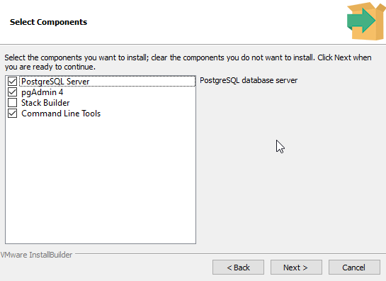

# PostgreSQL – instalace a připojení

PostgreSQL je relační databázový systém.

Pro práci lze použít konzoli psql nebo grafický klient pgAdmin.

## Instalace PostgreSQL ve Windows

1. Podporovaná verze a instalátor se vyberou z [oficiálního rozcestníku](https://www.postgresql.org/download/windows/).
2. V instalátoru EDB se zvolí server a **Command Line Tools**, případně také **pgAdmin 4**.
3. Následuje datový adresář, heslo databázového správce a port, který se hodí poznamenat. Běžný výchozí port je `5432`.
4. Po dokončení instalace se ověří, že databázová služba běží.

pgAdmin je samostatný klient.

Jeho přítomnost závisí na distribuci a volbě komponent.

### Výběr komponent



[Obrázek v původní velikosti](../images/wqiRRNNKOT.png)

## Výběr klienta pro připojení

<a id="připojení-z-příkazového-řádku"></a>
<a id="připojení-v-pgadminu"></a>

## [Příkazový řádek psql](#tab/postgres-psql)

Konzoli otevře **SQL Shell (psql)**, nebo v terminálu s dostupným `psql` tento příkaz:

```text
psql -h localhost -p 5432 -U postgres -d postgres
```

Heslo se zadává do výzvy, nikoli jako součást příkazu.

Po přihlášení následuje [společné ověření](#ověření-připojení).

V konzoli lze použít také:

| Syntaxe v konzoli psql | Význam |
|---|---|
| `\l` | Seznam databází |
| `\dt` | Tabulky v aktuálním vyhledávacím schématu |
| `\d <schéma>.<tabulka>` | Struktura vybrané tabulky. Doplňuje se její schéma a název |
| `\q` | Ukončení konzole |

Například `\d public.notes` zobrazí strukturu existující tabulky `notes` ve schématu `public`.

Zadává se do konzole psql, nikoli přímo do PowerShellu.

[Reference psql](https://www.postgresql.org/docs/current/app-psql.html)

## [Grafický pgAdmin](#tab/postgres-pgadmin)

Při registraci serveru se vyplní hostitel, port, databáze pro první připojení, uživatel a heslo odpovídající instalaci.

Po připojení se v **Query Tool** provede [společné ověření](#ověření-připojení). [Dialog serveru](https://www.pgadmin.org/docs/pgadmin4/latest/server_dialog.html)

***

## Ověření připojení

V připojené konzoli psql nebo v Query Tool pgAdminu se spustí:

```sql
SELECT version();
SELECT current_database(), current_user;
```

Aplikace dostávají samostatný účet s potřebnými oprávněními.

Správce `postgres` v tomto návodu slouží k ověření nové lokální instalace.

## Když se připojení nedaří

| Chyba | Co ověřit |
|---|---|
| `psql` nenalezen | Instalaci Command Line Tools a cestu k adresáři `bin` |
| Connection refused | Běh serveru, hostitele a port |
| Password authentication failed | Jméno databázového uživatele a jeho heslo |
| No pg_hba.conf entry | Pravidla přístupu pro konkrétního klienta a databázi |

Jazyk konzole není důvod měnit konfiguraci serveru.

Řeší se konkrétní chyba připojení. [Konfigurace přístupu](https://www.postgresql.org/docs/current/auth-pg-hba-conf.html)
