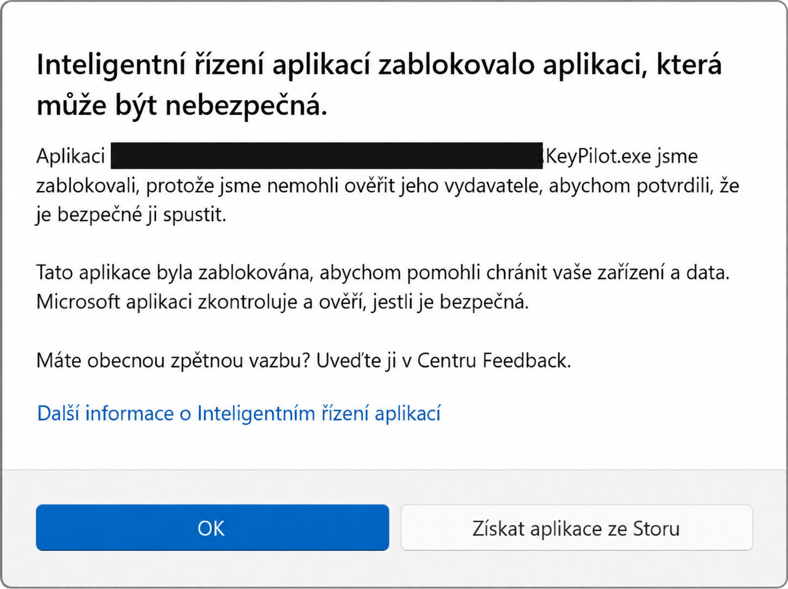

# Inteligentní řízení aplikací – zablokovaná aplikace

**Smart App Control**, česky **Inteligentní řízení aplikací**, ve Windows 11 blokuje aplikace, které vyhodnotí jako nebezpečné nebo nedůvěryhodné.

Pokud nedokáže určit jejich bezpečnost, kontroluje také důvěryhodný digitální podpis.

Proto může zastavit i vlastní nepodepsanou aplikaci. ([Microsoft: jak ochrana funguje](https://learn.microsoft.com/en-us/windows/apps/develop/smart-app-control/overview))

## Jak poznat toto blokování

Dialog uvádí **„Inteligentní řízení aplikací zablokovalo aplikaci, která může být nebezpečná.“** a název souboru, například `KeyPilot.exe`.

[Upravený obrázek v plném rozlišení](../../images/smart-app-control-blocked.png)

Osobní adresáře jsou na obrázku zakryté.

Samotné hlášení nedokazuje přítomnost malwaru, ale ani bezpečnost souboru.

## Před použitím

Postup platí pro aplikaci se známým a důvěryhodným původem.

Před změnou se ověří, zda autor nenabízí aktuální podepsanou verzi.

V Průzkumníku nabídne pravé tlačítko na souboru nebo složce aplikace **Zobrazit další možnosti → Zkontrolovat pomocí Microsoft Defender**.

Následuje výsledek kontroly. ([Microsoft: kontrola souboru](https://support.microsoft.com/en-gb/windows/scan-an-item-with-windows-security-d1c8c01d-12ed-e768-cbb8-830ea8ccf8e6))

Při jiném antiviru proběhne kontrola v něm.

Výsledek bez nálezu není zárukou bezpečnosti neznámé aplikace.

> [!WARNING]
> Vypnutí Inteligentního řízení aplikací platí pro celý počítač, nejen pro vybraný program.
>
> Výjimka pro jednu aplikaci není dostupná.
>
> Antivirová ochrana zůstává zapnutá.

Rozsah vypnutí a chybějící výjimky potvrzuje [FAQ Microsoftu](https://support.microsoft.com/en-us/windows/security/threat-malware-protection/smart-app-control-frequently-asked-questions).

## Postup krok za krokem

Ve Windows 11 s dostupným nastavením Smart App Control:

1. Blokovací dialog se zavře tlačítkem **OK**.
2. Z nabídky **Start** se otevře aplikace **Zabezpečení Windows**.
3. Vybere se **Řízení aplikací a prohlížečů**.
4. V části **Inteligentní řízení aplikací** se otevře jeho **nastavení** (*Smart App Control settings*).
5. Po přečtení upozornění Windows se zvolí **Vypnuto** (*Off*).
6. Výzvu správce potvrzuje jen ten, kdo smí tento počítač spravovat.
7. Ve složce aplikace se znovu otevře její `.exe` soubor, v uvedeném příkladu `KeyPilot.exe`.

Umístění voleb popisuje [Microsoft: řízení aplikací a prohlížečů](https://support.microsoft.com/en-us/windows/security/windows-security/app-browser-control-in-the-windows-security-app).

Na pracovním nebo školním zařízení s uzamčenými volbami řeší změnu správce.

## Ověření výsledku

V nastavení musí být vybrané **Vypnuto** a při novém spuštění má zmizet právě hlášení Inteligentního řízení aplikací.

Otevřít se má také hlavní okno aplikace.

Jiné chybové hlášení má samostatnou příčinu, proto se zaznamená jeho přesný text.

Toto nastavení neopravuje chybějící soubory aplikace ani jiné ochrany Windows.

## Opětovné zapnutí ochrany

Stejnou cestou se v nastavení Inteligentního řízení aplikací vybere **Zapnuto** (*On*), pokud je tato možnost dostupná.

Po novém otevření nastavení má být vybraný tento stav.

Aktuální [FAQ Microsoftu](https://support.microsoft.com/en-us/windows/security/threat-malware-protection/smart-app-control-frequently-asked-questions) uvádí, že nedávné aktualizace umožňují opětovné zapnutí bez čisté instalace Windows na podporovaných zařízeních.

Na starších sestaveních může návrat vyžadovat reset nebo přeinstalaci, proto před vypnutím platí také upozornění konkrétního systému.

Nedostupná volba **Zapnuto** vede ke kontrole aktualizací a podmínek v odkazovaném FAQ.

Po opětovném zapnutí může být stejná nepodepsaná aplikace znovu zablokovaná.

## Řešení pro autora aplikace

Distribuovaná vlastní aplikace potřebuje podpis kódu certifikátem od důvěryhodného poskytovatele.

Vlastní testovací certifikát sám tuto důvěru nenahrazuje.

Požadavky včetně podporovaných podpisů popisuje [Microsoft: podepsání aplikace pro Smart App Control](https://learn.microsoft.com/en-us/windows/apps/develop/smart-app-control/code-signing-for-smart-app-control).
