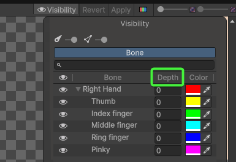
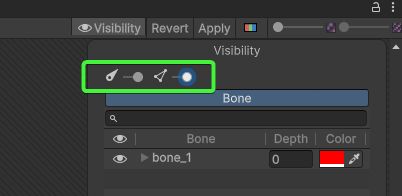
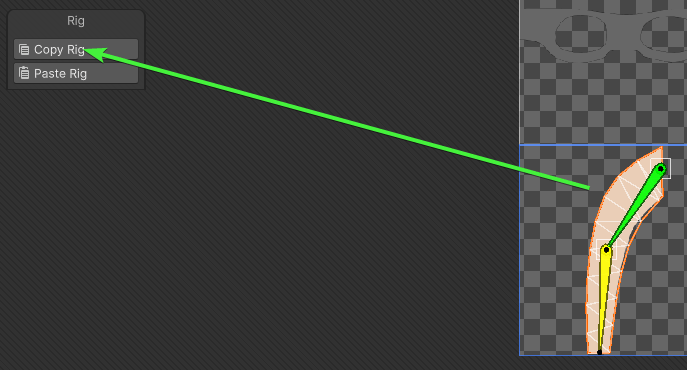
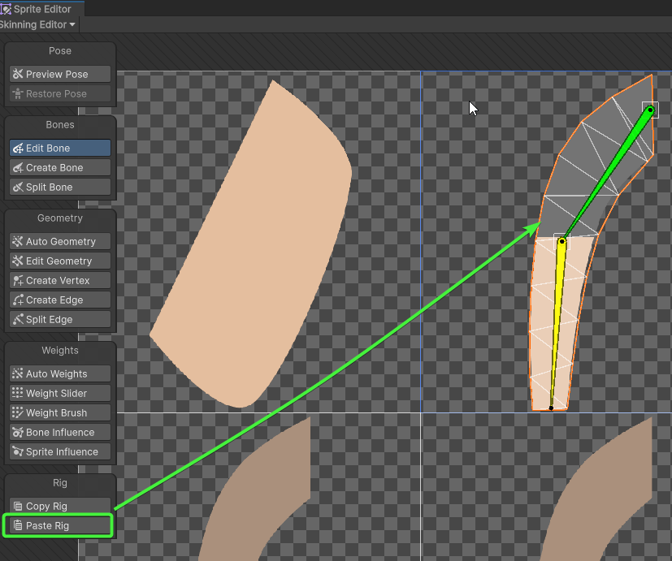
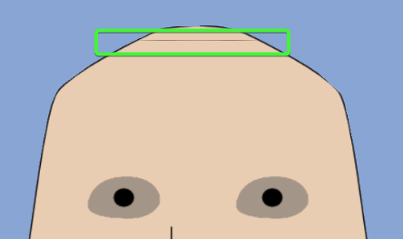
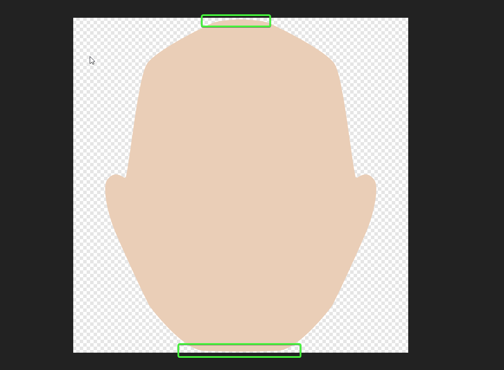
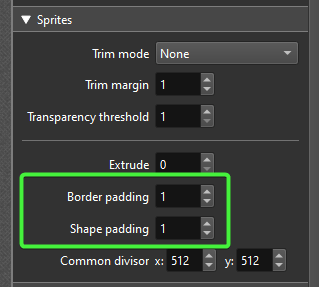
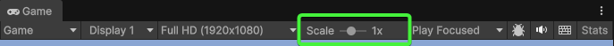

# Unity 2D: sprity, Tilemap a velikost grafiky

SpriteRenderer zobrazuje samostatný sprite, zatímco Tilemap skládá dlaždice do buněk mřížky.

Pro opakované pozadí nebo mapu se hodí Tilemap, pro samostatně pohyblivou postavu obvykle SpriteRenderer.

## Před použitím

Ukázka je pro Unity 6 s 2D Tilemap Editor a běžným Tile assetem.

Vznikne **Grid → Tilemap** a dlaždice se spritem a ověří se, že ji kamera vidí.

## Tilemap: vytvoření a obarvení dlaždic

Skript `TilemapExample.cs` se přidá na samostatný objekt a v Inspectoru se přiřadí výuková Tilemap i Tile asset.

Ukázka při startu vymaže obsah přiřazené Tilemap, proto se nepoužívá na hotovou ručně vytvořenou mapu.

```csharp
using UnityEngine;
using UnityEngine.Tilemaps;

/// <summary>Vytvoří a obarví obdélník dlaždic ve výukové mapě.</summary>
public class TilemapExample : MonoBehaviour
{
    [SerializeField] private Tilemap tilemap;
    [SerializeField] private TileBase tile;
    [SerializeField, Min(1)] private int width = 8;
    [SerializeField, Min(1)] private int height = 4;
    [SerializeField] private Color tint = Color.cyan;

    private void Start()
    {
        if (tilemap == null || tile == null)
        {
            Debug.LogError("Přiřaď Tilemap i Tile asset.", this);
            return;
        }
        tilemap.ClearAllTiles();
        for (int x = 0; x < width; x++)
        for (int y = 0; y < height; y++)
        {
            var position = new Vector3Int(x, y, 0);
            tilemap.SetTile(position, tile);
            // Odemyká se jen barva; ostatní příznaky dlaždice zůstávají.
            var flags = tilemap.GetTileFlags(position);
            tilemap.SetTileFlags(position, flags & ~TileFlags.LockColor);
            tilemap.SetColor(position, tint);
        }
    }
}
```

Po spuštění se zobrazí obdélník 8 × 4 dlaždic s azurovým tónováním.

Dva oddělené cykly nejsou obecnou podmínkou změny barvy.

Zásadní je pořadí vložení dlaždice a příznak `LockColor`.

Příznaky vysvětluje [Unity TileFlags](https://docs.unity3d.com/6000.0/Documentation/ScriptReference/Tilemaps.TileFlags.html).

Vlastní RuleTile může při obnově nastavovat vlastní barvu, proto se u něj ověří i implementace pravidel.

## Velikost obrázku a PPU

**Pixels Per Unit** určuje počet pixelů zdrojového spritu na jednu světovou jednotku při měřítku Transformu 1.

Šířka ve scéně je `šířka v pixelech / PPU`, nikoli pevně daná vzdáleností od kamery.

| Sprite | PPU | Velikost ve scéně |
|---|---|---|
| 32 × 32 px | 32 | 1 × 1 jednotka |
| 64 × 32 px | 32 | 2 × 1 jednotka |
| 256 × 256 px | 256 | 1 × 1 jednotka |

Společná pixelová kresba drží konzistentní PPU a rozlišení se vybírá podle požadovaného detailu při cílovém zobrazení.

Mocniny dvou mohou být relevantní pro textury, kompresi a atlas, ale nejsou univerzální povinností pro rozměr každého jednotlivého spritu.

## Animace: předpoklady

Následující obrázkové postupy vyžadují kompatibilní balíček **2D Animation**, Sprite Editor a připravenou geometrii spritu.

Kosti určují transformace, weights vliv kostí na vrcholy a depth pořadí překrývajících se částí.

Při kopírování rigu se ověří názvy kostí, geometrie a váhy nového spritu.

Podobný obrázek sám nezaručuje stejné deformace.

## Animace obrázku

<details>
<summary>Hloubka (Depth) u kostí</summary>

> Hloubka ovlivňuje pořadí vykreslení Sprite Mesh.

1. Otevře se `Sprite Editor`
2. Následuje přepnutí do `Skinning Editor`
3. U kostí se nastaví hloubka



[Obrázek v původní velikosti](../../images/2D_rigging_depth.png)

</details>

<details>
<summary>Univerzální Rigging</summary>

1. Otevře se `Sprite Editor`
2. Následuje přepnutí do `Skinning Editor` (s aktivním `Visibility`)
3. Vytvoří se kosti (bones)
4. Nastaví se Geometry a Weights

> Pokud se část nevykresluje barevně, rozhoduje nastavení posuvníků:



[Obrázek v původní velikosti](../../images/2D_rigging_skinWeight.png)

5. Rig se zkopíruje

   

[Obrázek v původní velikosti](../../images/2D_rigging_copy.png)

6. Otevře se nový sprite
7. Rig se vloží

   

[Obrázek v původní velikosti](../../images/2D_rigging_paste.png)

</details>

## Řešení chyb při vykreslování spritu

Nejprve se ověří import textury, atlas a cílové rozlišení.

[Pixel Perfect Camera](camera.md#pixel-perfect-camera) pomáhá pixel artu, ale není povinná pro všechny 2D projekty.

<details>
<summary>Černé čáry</summary>



[Obrázek v původní velikosti](../../images/2D_sprite_blackLines.png)

**Řešení:**

- Kontrola umístění obrázku

  

[Obrázek v původní velikosti](../../images/2D_sprite_blackLines_solution.png)

- Padding v `TexturePacker`

  

[Obrázek v původní velikosti](../../images/2D_sprite_blackLines_solution2.png)

| Typ paddingu | Popis |
|-------------------|-----------------------------------------------|
| Border padding | Mezera kolem okrajů celého sheetu |
| Shape padding | Mezera mezi jednotlivými sprites na sheetu |

> Zvyš padding, pokud se problém opakuje.

</details>

<details>
<summary>Problikávání</summary>

Měřítko v herním okně má být nastavené na **1x**.



[Obrázek v původní velikosti](../../images/2D_sprite_blackLines_solutionCamera.png)

</details>
