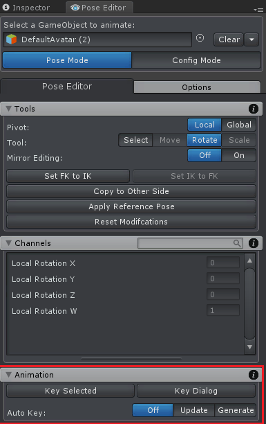

# UMotion – Klíčování animací v Unity

> Praktické tipy pro efektivní práci s UMotion při ukládání změn animací.

UMotion je doplněk editoru pro práci s animacemi.

Předpokladem je nainstalovaná kompatibilní verze, otevřený UMotion projekt a vybraný klip.

Změna pózy sama není uložený animační klíč ani exportovaný AnimationClip.

## Uložení změn v UMotion

| 🏷️ Způsob | 💡 Popis |
|-------------------|--------------------------------------------------------------------------|
| Key Selected | Vytvoří nebo upraví klíče pro vybrané kosti/transformace. |
| Auto Key | UMotion automaticky klíčuje změny při úpravě. |
| Key Dialog | Přehledně zobrazí změny a umožní je klíčovat. |

[Obrázek v původní velikosti](../../images/WHDIpG6Uzg.png)

## Postup klíčování

1. Vyberou se animované kosti nebo transformace.
2. **Key Selected** slouží pro ruční klíčování, **Auto Key** pro automatické klíčování.
3. **Key Dialog** slouží pro kontrolu a úpravu klíčů.
4. Změny animace se uloží.

## Ověření a důležité poznámky

Po vytvoření klíče se časový kurzor přesune jinam a vrátí zpět.

Očekávaná póza musí zůstat zachovaná.

UMotion projekt se uloží a při použití v Animatoru se ověří i exportovaný klip, protože jde o samostatné artefakty.

Auto Key se zapíná vědomě, aby při pouhé úpravě pózy nevznikly nechtěné klíče.

Detaily exportu a rozdíly formátů popisuje [manuálu UMotion](https://soxware.com/umotion-manual/ImportExport.html).
