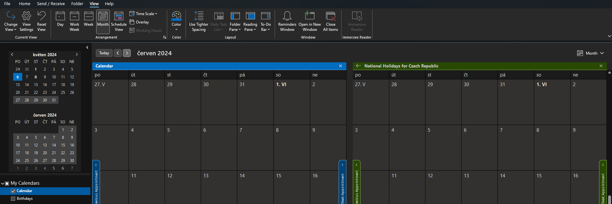
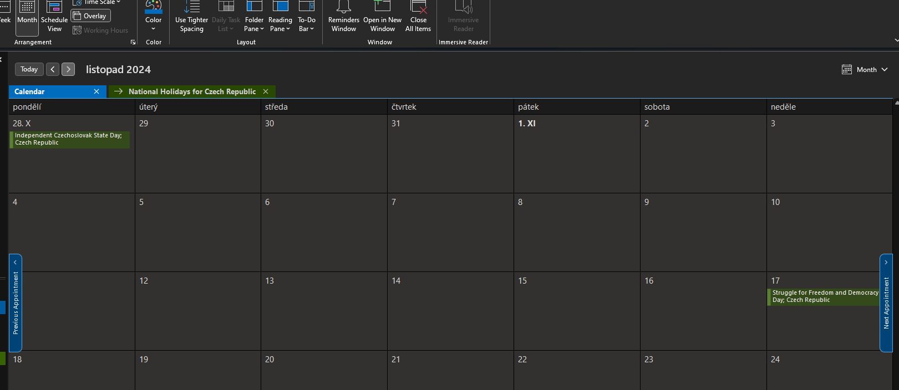

# Outlook – zobrazení více kalendářů

Kalendáře lze zobrazit vedle sebe nebo překrýt pro snadnější porovnání termínů.

## Verze Outlooku

## [Klasický Outlook](#tab/outlook-classic)

Postup je pro klasický Outlook ve Windows.

1. V kalendáři se v levém panelu zaškrtne další kalendář.
2. Šipka **View in Overlay Mode** na jeho záložce kalendáře překryje.
3. **View in Side-by-Side Mode** je vrátí vedle sebe.

Jde o změnu zobrazení, nikoli sloučení událostí do jednoho kalendáře. [Porovnání kalendářů](https://support.microsoft.com/en-US/Outlook/calendar/view-multiple-calendars-at-the-same-time-in-outlook)

**Oddělené zobrazení**

[Obrázek v původní velikosti](../images/outlook_calendarBeforeOverlay.png)

**Překryté zobrazení**

[Obrázek v původní velikosti](../images/outlook_calendarAfterOverlay.png)

## [Nový Outlook a web](#tab/outlook-new)

Po výběru kalendářů je volba **Split view** v nabídce uspořádání zobrazí vedle sebe.

Vypnutí této volby je překryje. [Postup pro nový Outlook a web](https://support.microsoft.com/en-US/Outlook/calendar/view-multiple-calendars-at-the-same-time-in-outlook)

***
